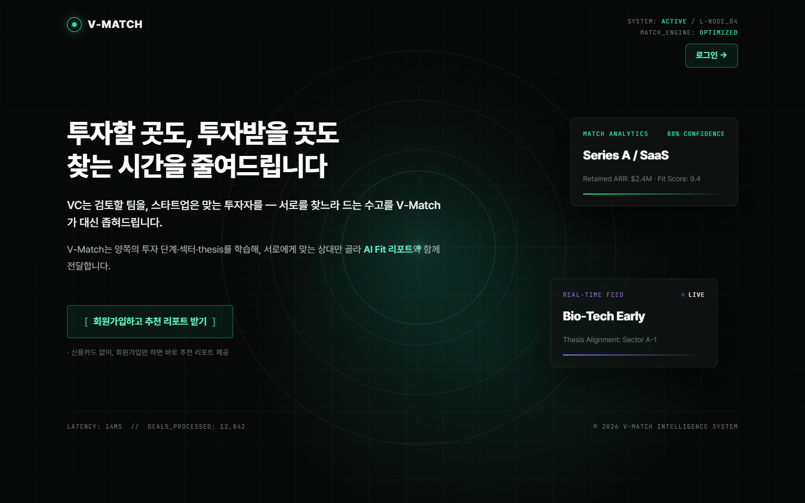
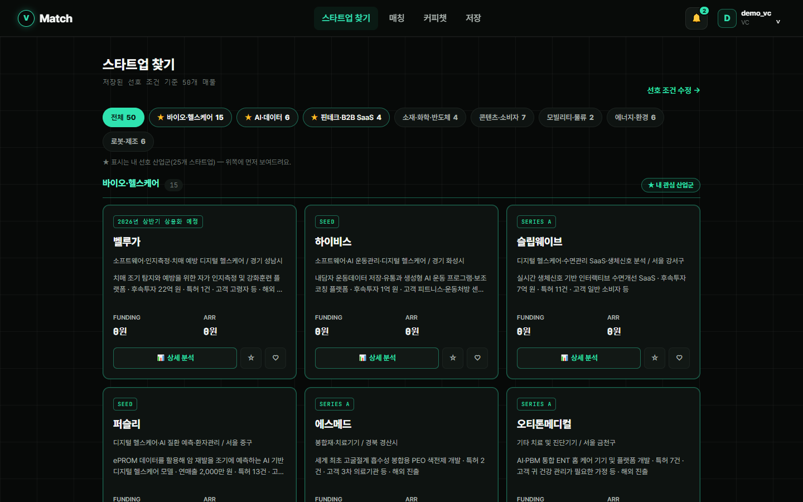
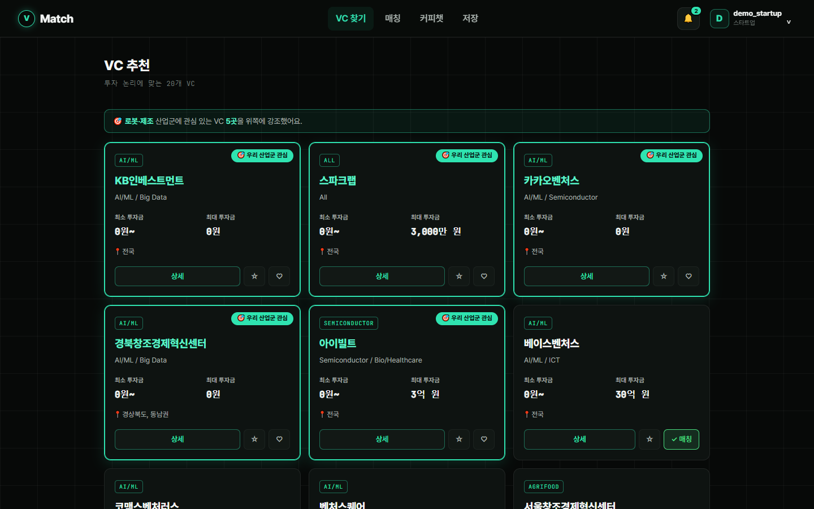
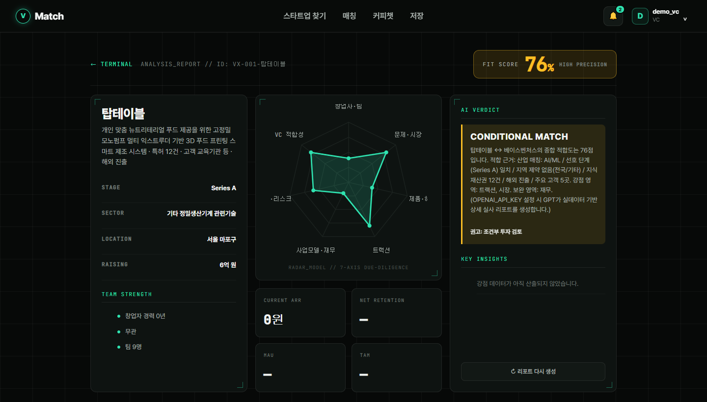
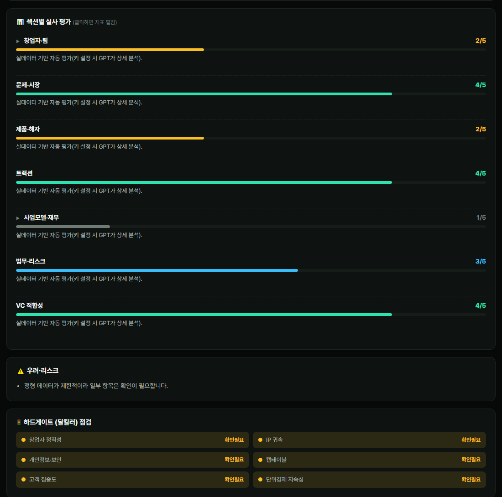

# V-Match

[](https://github.com/XXXXXim/v-match/actions/workflows/tests.yml)

### ▶ [라이브 데모 써보기](https://v-match-one.vercel.app/login)

로그인 화면의 **VC로 로그인 / 스타트업으로 로그인** 버튼을 누르면 바로 들어갑니다. API 키 없이 폴백 모드로 동작합니다.

1. **VC로 로그인** → 상단 **매칭** 메뉴에 데모 스타트업(탑테이블)과 이미 성사된 매칭이 있습니다.
2. 매칭 상세에서 **FIT 점수 · 7축 레이더 · AI 실사 리포트**를 확인합니다.
3. **스타트업 찾기 / VC 추천**에서 다른 회사에 좋아요를 눌러 추천 결과와 알림 흐름도 볼 수 있습니다.

> 데모는 Vercel 서버리스 함수가 각자 시드 DB 사본을 쓰는 구조라, 새로 누른 좋아요·매칭은 잠시 뒤 처음 상태로 돌아가거나 다른 화면에서 안 보일 수 있습니다. 데모 계정과 기본 매칭은 항상 유지됩니다. 새 회원가입은 인증 메일이 실제로 발송되지 않으니 데모 계정을 이용해 주세요.

> **VC와 스타트업을 양방향으로 연결하는 AI 투자 매칭 플랫폼**
> 결정론적 FIT 점수로 추천하고, LLM이 실사(Due Diligence) 형식의 분석 리포트를 만들어 줍니다.



## 화면

| VC: 스타트업 찾기 | 스타트업: VC 추천 |
|---|---|
|  |  |
| VC가 저장해 둔 선호 조건으로 바로 결과를 봅니다. 관심 산업군이 맨 위에 옵니다. | 우리 산업군에 관심 있는 VC를 강조해서 보여 줍니다. |

**매칭 상세: FIT 점수, 7축 레이더, AI 판정**


**AI 실사 리포트: 섹션별 평가와 하드게이트(딜킬러) 점검**


> 스크린샷은 API 키 없이 폴백 모드로 찍었습니다. FIT 점수는 키가 있든 없든 결정론 엔진이 계산합니다. 섹션 평가는 지금 결정론 골격이 채운 값이고, 키를 설정하면 섹션 평가와 서술을 LLM이 생성합니다.

## 한눈에 보기

| 항목 | 내용 |
|---|---|
| 기간 | 2026.06 (7일 스프린트) · SSAFY 15기 관통 프로젝트 |
| 팀 | 2인 · 심혁 (기여도 60%) · 박은서 (40%) · [역할 분담](#역할-분담) |
| Backend | Django 5, Django REST Framework, SQLite, DRF Token 인증 |
| Frontend | Vue 3, Vue Router, Pinia (+persistedstate), Axios, Bootstrap 5, Vite |
| AI | OpenAI Chat Completions (AI 실사 리포트), Anthropic API (인라인 설명), 키가 없으면 템플릿으로 폴백 |
| 테스트 | Django TestCase 24개 (보안 회귀 테스트 16개 포함) |

## 핵심 기능

- **양방향 추천**: VC가 보는 스타트업 추천과 스타트업이 보는 VC 추천.
- **소개팅식 매칭**: 한쪽이 좋아요를 누르면 상대에게 알림이 가고, 서로 좋아요하면 매칭됩니다.
- **AI 실사 리포트**: 7개 섹션을 0~5점으로 평가하고, 강점과 우려, 딜킬러(하드게이트) 점검, 투자 권고 밴드(적극 / 조건부 / 관찰 / 신중)를 함께 보여 줍니다.
- **단계별 정보 공개**
  - 매칭 전에는 피치덱, 요약, 레이더 차트만 공개합니다.
  - 매칭되고 양측이 NDA에 동의해야 IR 원본과 연락처가 열립니다.
- **커피챗 워크플로우**: 요청하고 NDA에 동의한 뒤 상대가 수락하면, AI가 양측에 미팅 준비 브리핑(예상 질문, 체크포인트)을 만들어 줍니다.
- **이메일 인증**: 6자리 코드에 만료 시간, 시도 횟수 제한, 재발송 간격 제한을 둡니다.
- **IR 요약 검수**: AI가 초안을 쓰면 창업자가 수정하고 승인합니다. 공개로 설정한 경우에만 VC가 볼 수 있습니다.

## 설계 포인트

### 1. 점수는 결정론적으로, LLM은 설명만
같은 입력이면 항상 같은 점수가 나와야 신뢰할 수 있습니다. 그래서 FIT 점수는 룰 기반으로 계산하고, LLM에는 계산된 점수와 근거 데이터를 **입력으로만** 넘겨서 서술만 쓰게 했습니다.

| 구분 | 항목 (가중치) | 소계 |
|---|---|---|
| 투자 조건 적합도 | 산업 20 · 단계 12 · 지역 8 | 40 |
| 스타트업 역량 | IP·특허 16 · 트랙션 18 · 팀 8 · 매출 8 · 후속투자 4 · 성숙도 6 | 60 |

- 가중치는 [`backend/core/recommend.py`](backend/core/recommend.py)의 `W_THESIS`, `W_STRENGTH`에 있습니다.
- 인접한 투자 단계에는 부분 점수를 줍니다.
- 산업 `All`과 지역 `전국`은 와일드카드로 만점 처리합니다.
- 한글로 적힌 세부 산업은 키워드로 표준 카테고리를 추론합니다.
- 초기 딥테크처럼 매출이 0인 기업도 특허, 고객사, 해외 진출 신호로 평가합니다. 예전에는 매출 165억 원인 기업이 17점으로 나왔는데, 이 개선 후 90점이 됐습니다.

### 2. LLM 비용과 지연 관리
- **지연 생성**: AI 리포트는 좋아요를 누르는 순간이 아니라 매칭 상세를 열 때 만듭니다. 동기 호출 때문에 좋아요 응답이 멈추던 버그를 이렇게 해결했습니다.
- **캐시**: 결과는 (VC, 스타트업) 쌍마다 저장합니다. 캐시 키에 프로필의 `updated_at`을 넣어서, 프로필이 바뀌면 자동으로 다시 생성됩니다.
- **폴백**: API 키가 없거나 호출이 실패해도 결정론 골격과 템플릿으로 응답하므로 데모가 깨지지 않습니다.
- **요청 제한**: AI 엔드포인트에 throttle(분당 6회)을 걸었습니다.

### 3. 보안 (리뷰 결과 반영)
자세한 내용은 [`SECURITY_FIXES.md`](SECURITY_FIXES.md)에 있습니다. 모든 수정은 결함을 먼저 테스트로 재현한 뒤에 고쳤습니다.
- **IR 노출 차단**: 공개용과 본인용 시리얼라이저를 분리했습니다. IR 파일은 공개 `/media` 밖(`protected_media`)에 저장하고, 권한을 검사하는 다운로드 API로만 내려줍니다.
- **이메일 인증 우회 차단**: 전역 권한 `IsEmailVerified`를 추가했습니다.
- **역할 교차 생성 차단**: VC 계정이 스타트업 프로필을 만드는 식의 생성을 막았습니다.
- **운영 설정 분리**: `SECRET_KEY`, `DEBUG`, `ALLOWED_HOSTS`를 환경 변수로 옮기고 HSTS, secure 쿠키 등 보안 헤더를 켰습니다.

## 프로젝트 구조

```
v-match/
├── backend/                 # Django + DRF
│   ├── accounts/            # 회원·이메일 인증·권한(IsEmailVerified)·throttle
│   ├── config/              # settings (환경변수 기반)
│   └── core/
│       ├── recommend.py     # 결정론 FIT 점수 엔진
│       ├── evaluate.py      # 역량 차원 점수 + 단계/VC 맞춤 가중
│       ├── ai_report.py     # AI 실사 리포트 (PDF 텍스트 추출 → LLM → JSON)
│       ├── ai.py            # 인라인 AI 설명 / 미팅 브리핑
│       ├── data/            # 공개 자료 기반 VC 20 · 스타트업 50 시드 데이터
│       └── management/commands/  # seed_*, summarize_startups, check_ai ...
├── frontend/                # Vue 3 SPA
│   └── src/{views,components,stores,router,api}
└── docs/
    ├── ERD.md               # 데이터 모델 설계
    └── CHANGELOG.md         # v1 ~ v15 개발 이력
```

## 실행 방법

### 백엔드
```bash
cd backend
python -m venv .venv
source .venv/bin/activate             # Windows: .venv\Scripts\activate
pip install -r requirements.txt
cp .env.example .env                  # 로컬은 DJANGO_DEBUG=true 로 변경
python manage.py migrate
python manage.py seed_real_vcs        # VC 20곳
python manage.py seed_real_startups   # 스타트업 50곳
python manage.py seed_demo            # 라이브 데모 계정 (demo_vc / demo_startup, 비밀번호 demo1234)
python manage.py runserver            # http://127.0.0.1:8000
```
> Windows 콘솔에서 `UnicodeEncodeError`(cp949)가 나면 `set PYTHONUTF8=1`을 먼저 실행하세요.

AI 기능을 쓰려면 `backend/.env`에 `OPENAI_API_KEY`를 넣으세요. 키가 없어도 템플릿 폴백으로 모든 화면이 동작합니다.

### 프론트엔드
```bash
cd frontend
npm install
npm run dev                           # http://localhost:5173
```

### 테스트
```bash
cd backend
python manage.py test                 # 24 tests
```

## 데모 시나리오
1. 브라우저 A에서 `demo_startup`으로 로그인하고, VC 추천 목록에서 데모 VC에 좋아요를 누릅니다.
2. 브라우저 B에서 `demo_vc`로 로그인하면 알림 배지가 보입니다. 스타트업 찾기에서 그 스타트업에 좋아요를 누르면 **매칭이 성사**됩니다.
3. 매칭 상세에서 **AI 실사 리포트**를 확인합니다.
4. 커피챗을 요청하고 NDA에 동의한 뒤 상대가 수락하면, IR 원본·연락처·AI 미팅 브리핑이 열립니다.

## 주요 API

| 메서드 | 경로 | 설명 |
|---|---|---|
| POST | `/api/accounts/signup/` · `login/` · `verify-email/` | 가입 · 로그인 · 이메일 인증 |
| GET | `/api/recommendations/` | (VC) 스타트업 추천 |
| GET | `/api/vc-recommendations/` | (스타트업) VC 추천 |
| POST | `/api/likes/{startup\|vc}/<id>/toggle/` | 좋아요 → 알림 / 매칭 |
| GET | `/api/matches/` · `/api/matches/<id>/` | 매칭 목록 · 상세 |
| GET | `/api/matches/<id>/ai-report/` | AI 실사 리포트 |
| POST | `/api/matches/<id>/request/` · `accept/` · `decline/` | 커피챗 + NDA |
| GET | `/api/ir-decks/<id>/download/` | 권한 검사를 거치는 IR 원본 다운로드 |
| GET | `/api/notifications/` | 알림 목록 |

전체 목록은 [`backend/core/urls.py`](backend/core/urls.py)를 보세요.

## 데이터에 대하여
- VC와 스타트업 시드는 **공개 자료**(TIPS 운영사·선정기업 공개 정보, 각 사 홈페이지)를 바탕으로 정리했습니다.
- 투자 희망 금액처럼 공개되지 않은 항목은 **데모용 추정치**입니다.
- 대표자 개인정보(성명, 생년, 개인 이메일, 연락처)는 저장소에서 제외했습니다.
- 데모 계정과 테스트 데이터는 모두 가상입니다.

## 역할 분담

| 영역 | 심혁 (60%) | 박은서 (40%) |
|---|---|---|
| 기획 | 서비스 컨셉 구상, 사용자 플로우 설계 (추천 → 좋아요 → 매칭 → 리포트 → 미팅) | 화면 흐름 정리, 기능 명세 검토 |
| 백엔드 | 데이터 모델링, 회원가입·이메일 인증, 추천·매칭·커피챗 API, FIT 점수 엔진 (`recommend.py`, `evaluate.py`) | 알림·북마크 API 보조 |
| AI | AI 실사 리포트 파이프라인 (`ai_report.py`): 프롬프트 설계, 결정론 점수와 LLM 서술 분리, 폴백·캐시 | 리포트 결과 화면 검수 |
| 프론트엔드 | 매칭 상세·AI 리포트 화면 데이터 연동 | Vue 컴포넌트 설계와 구현: 랜딩, 추천 목록, 매칭 상세, 커피챗 채팅 화면 |
| 데이터 | 시드 명령 작성, 단계·금액 정규화, 데이터 검증 | 스타트업·VC 공개 자료 (PDF)를 수작업으로 JSON 데이터셋으로 정리 |
| 품질 | 보안 리뷰 반영 (IR 접근 제어, 인증 우회 차단), 테스트 작성 | 화면별 QA, 시나리오 테스트 |
| 발표 | 발표 및 문서화 (README, 보안 수정 내역) | 발표 자료 디자인, ERD·WBS 정리 |

## 회고

### 어려웠던 점과 해결
- **AI 리포트가 실행할 때마다 달라짐**
  - 같은 매칭인데도 재요청할 때마다 점수와 추천 이유가 바뀌어 신뢰하기 어려웠습니다.
  - 점수는 룰 기반 엔진이 계산하고, LLM은 그 점수와 근거를 입력으로 받아 서술만 하도록 역할을 나눴습니다.
  - 프롬프트를 다듬고 모델을 GPT-4o-mini에서 상위 모델로 올리니 서술 품질도 크게 좋아졌습니다.
- **커피챗 동시 신청 오류**
  - 스타트업과 VC가 거의 동시에 서로에게 신청하면 채팅방이 만들어지지 않았습니다.
  - 매칭 상태를 `matched → requested → accepted`로 정리하고, 누가 먼저 신청했는지(`requested_by`)를 기록했습니다.
  - 이미 신청된 매칭에 상대가 다시 신청하면 막고, 수락 흐름으로만 진행되게 해서 양쪽이 신청해도 매칭이 정상적으로 성립합니다.
- **우량 기업이 낮은 점수를 받는 문제**
  - 매출 165억 원, 특허 236건인 기업이 17점으로 나왔습니다. 비어 있는 숫자 필드(MAU 등)만 보고 점수를 매겼기 때문입니다.
  - 특허, 후속투자, 해외 진출, 고객사 같은 실데이터 신호로 역량 점수를 다시 설계해 90점으로 바로잡았습니다.
- **NDA 전 IR 원본 노출**
  - 리뷰에서 매칭 전에도 IR PDF 주소가 응답에 섞여 나가는 결함을 찾았습니다.
  - 공개용과 본인용 시리얼라이저를 분리하고, 권한을 검사하는 다운로드 API를 만들었습니다.
  - 결함을 먼저 테스트로 재현한 뒤 고쳐서, 다시 생기지 않게 막았습니다.

### 배운 점
- **양방향 서비스는 두 번 설계해야 한다**: VC 쪽에서 잘 되는 기능도 스타트업 쪽에서는 깨질 수 있었습니다. 모든 기능을 양쪽 입장에서 따로 검증해야 했습니다.
- **LLM은 판단보다 설명에 둔다**: 점수처럼 재현성이 필요한 부분은 코드로 계산하고, LLM은 설명에 쓸 때 신뢰도와 비용을 함께 잡을 수 있었습니다.
- **데이터는 정직하게**: 비상장사의 투자 정보는 대부분 비공개라, 실제 자료와 추정치를 구분해 표기하는 것도 서비스 품질의 일부라는 걸 배웠습니다.

### 아쉬운 점과 다음 단계
- 7일 일정 때문에 K-Startup·DART·The VC 같은 외부 데이터를 자동으로 연동하지 못하고 수작업 JSON에 머물렀습니다. 다음 단계는 자동 수집과 정규화 파이프라인입니다.
- 페이지네이션과 N+1 쿼리 최적화, 업로드 파일 MIME·크기 검증, 실제 배포는 후속 과제로 남겼습니다.

## 문서
- [ERD](docs/ERD.md)
- [개발 이력 v1~v15](docs/CHANGELOG.md)
- [보안 수정 내역](SECURITY_FIXES.md)
